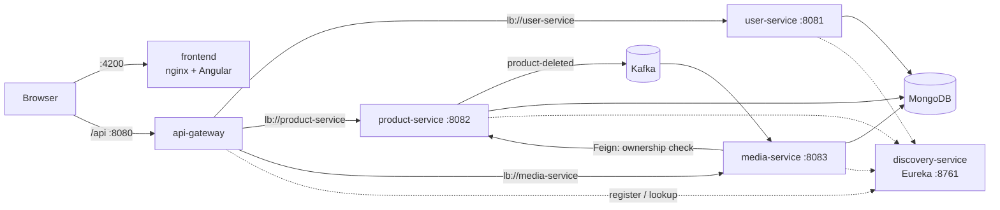

# buy-01

buy-01 is a small e-commerce platform built with **Spring Boot microservices** and an **Angular** frontend, deployed with **Docker Compose** and delivered by a **Jenkins** CI/CD pipeline.

## 1. Project overview

- **Users and roles**: anyone can register as a `CLIENT` or a `SELLER`. Login returns a JWT that the frontend sends on every request.
- **Products**: everyone (even anonymous visitors) can browse the product catalogue. Only a `SELLER` can create products, and only the seller who owns a product can update or delete it.
- **Media**: sellers upload images for their own products. Only image files (`image/*`) up to **2 MB** are accepted. Images are served publicly.
- **Events**: when a product is deleted, `product-service` publishes a `ProductDeletedEvent` on the Kafka topic `product-deleted`, and `media-service` deletes the media records linked to that product.

## 2. Architecture

All traffic from the browser goes through the **API Gateway**. The gateway validates the JWT and forwards the user identity to the services in the `X-User-Id` and `X-User-Role` headers. Services find each other through **Eureka**.

| Container | Port (host → container) | Role |
|---|---|---|
| `frontend` | `4200` → `80` (`FRONTEND_PORT`) | Angular app served by nginx |
| `api-gateway` | `8080` → `8080` (`GATEWAY_PORT`) | Single entry point. Routes `/api/**`, checks JWTs, CORS |
| `discovery-service` | `8761` → `8761` (`EUREKA_PORT`) | Eureka server (service registry + dashboard) |
| `user-service` | internal `8081` | Register, login, JWT creation, user profile |
| `product-service` | internal `8082` | Product CRUD, publishes Kafka events |
| `media-service` | internal `8083` | Image upload/download, Kafka consumer. Asks `product-service` (OpenFeign) whether the user owns the product |
| `mongodb` | internal `27017` | MongoDB 7.0. One database per service: `buy01_users`, `buy01_products`, `buy01_media` |
| `kafka` | internal `9092` | Apache Kafka 4.0, single node, KRaft mode (no Zookeeper) |
| `kafka-ui` *(optional)* | `8085` → `8080` | Kafka web UI, only started with `--profile tools` |
| `jenkins` *(separate compose file)* | `8000` → `8080`, `50000` | CI/CD server |

"Internal" means the port is only reachable inside the Docker network `buy01-network`.



Gateway routes (`infrastructure/api-gateway/src/main/resources/application.yaml`):

| Path | Service |
|---|---|
| `/api/auth/**`, `/api/users/**` | `user-service` |
| `/api/products/**` | `product-service` |
| `/api/media/**` | `media-service` |

Public routes (no token needed): `POST /api/auth/login`, `POST /api/auth/register`, `GET /api/products/**`, `GET /api/media/**`, `GET /actuator/health`. Every other request needs an `Authorization: Bearer <token>` header.

## 3. Tech stack

Versions come from `pom.xml`, `package.json`, the Dockerfiles and `docker-compose.yml`.

**Backend**
- Java 17
- Spring Boot 3.5.11 (Web, Security, Validation, Data MongoDB, Actuator)
- Spring Cloud 2025.0.1 (Gateway Server WebFlux, Netflix Eureka, OpenFeign)
- Spring for Apache Kafka (version managed by Spring Boot)
- JJWT 0.12.6
- Lombok
- Maven Wrapper (Maven 3.8.7 in `services/`, 3.9.12 in `infrastructure/*`)
- Tests: JUnit 5 + Mockito (from `spring-boot-starter-test`)

**Frontend**
- Angular 21.2 (`@angular/core ^21.2.0`, `@angular/cli ^21.2.1`)
- TypeScript ~5.9.2, RxJS ~7.8.0, Bootstrap ^5.3.8
- Tests: Vitest ^4.0.8 with jsdom ^28.0.0 (Angular `@angular/build:unit-test` builder)

**Infrastructure**
- MongoDB `mongo:7.0`
- Kafka `apache/kafka:4.0.0` (KRaft)
- Docker images: `maven:3.9-eclipse-temurin-17` (build) → `eclipse-temurin:17-jre-alpine` (run); `node:22-alpine` (build) → `nginx:1.29-alpine` (run)
- Jenkins `jenkins/jenkins:lts-jdk17` with Docker CLI, Docker Compose/buildx plugins, Node.js and npm

## 4. Getting started

### Prerequisites
- Docker with the Docker Compose v2 plugin (`docker compose ...`)
- Optional, to run things without Docker: JDK 17, Node.js 20.19+ or 22, npm

### Run the whole stack

```bash
git clone https://github.com/saljaoui/buy-01.git
cd buy-01
cp .env.example .env
# edit .env and set JWT_SECRET, for example with: openssl rand -hex 32
docker compose up -d --build
docker compose ps        # wait until the services show "healthy"
```

Variables in `.env` (see `.env.example`):

| Variable | Required | Default | Used by |
|---|---|---|---|
| `JWT_SECRET` | yes | – | `api-gateway`, `user-service` (at least 32 bytes) |
| `JWT_EXPIRATION` | no | `24h` | `user-service` |
| `GATEWAY_PORT` | no | `8080` | host port of the gateway |
| `FRONTEND_PORT` | no | `4200` | host port of the frontend |

`docker-compose.yml` also accepts `EUREKA_PORT` (default `8761`).

> The frontend calls the API at `http://localhost:8080/api` (`frontend/src/environments/environment.ts`). If you change `GATEWAY_PORT`, you must change this file too.

### URLs

| What | URL |
|---|---|
| Frontend | http://localhost:4200 |
| API Gateway | http://localhost:8080/api/... |
| Gateway health | http://localhost:8080/actuator/health |
| Eureka dashboard | http://localhost:8761 |
| Kafka UI (optional) | http://localhost:8085 after `docker compose --profile tools up -d kafka-ui` |

Stop everything with `docker compose down` (add `-v` to also delete the MongoDB data and uploaded images).

### Frontend pages

| Route | Who | Page |
|---|---|---|
| `/products` | everyone | Product list (home page) |
| `/products/:id` | everyone | Product details with images |
| `/login`, `/register` | not logged in | Login / register |
| `/seller` | `SELLER` | Seller dashboard |
| `/seller/products/new`, `/seller/products/:id/edit` | `SELLER` | Create / edit a product |
| `/seller/media` | `SELLER` | Manage product images |
| `/seller/profile` | `SELLER` | Seller profile |

## 5. API endpoints

All paths go through the gateway (`http://localhost:8080`).

### user-service

| Method | Path | Auth | Description |
|---|---|---|---|
| GET | `/api/auth/ping` | token* | Health test, returns `pong` |
| POST | `/api/auth/register` | public | Create an account. Body: `name`, `email`, `password` (min 8), `role` (`CLIENT`/`SELLER`), `avatar` (optional). Returns a token + user |
| POST | `/api/auth/login` | public | Body: `email`, `password`. Returns a token + user |
| GET | `/api/users/me` | logged in | Get the current user |
| PUT | `/api/users/me` | logged in | Update the current user's `name` and/or `avatar` |

\* `user-service` allows `/api/auth/**` without a token, but the gateway only lets `login` and `register` through without one.

### product-service

| Method | Path | Auth | Description |
|---|---|---|---|
| GET | `/api/products` | public | Paginated product list (`?page=&size=&sort=`). Each item has `owner: true/false` for the current user |
| GET | `/api/products/{id}` | public | One product |
| POST | `/api/products` | `SELLER` | Create a product. Body: `name`, `description`, `price` (> 0), `quantity` (≥ 0) |
| PUT | `/api/products/{id}` | `SELLER`, owner | Update a product |
| DELETE | `/api/products/{id}` | `SELLER`, owner | Delete a product and publish `ProductDeletedEvent` to Kafka |
| GET | `/internal/products/{productId}/ownership?userId=` | internal only | Used by `media-service` through Feign. Not routed by the gateway |

### media-service

| Method | Path | Auth | Description |
|---|---|---|---|
| POST | `/api/media` | `SELLER`, owner of the product | Upload an image (`multipart/form-data`: `file`, `productId`). Only `image/*`, max 2 MB |
| GET | `/api/media/{id}` | public | Download the image bytes |
| GET | `/api/media/product/{productId}` | public | List the media of a product |
| DELETE | `/api/media/{id}` | `SELLER`, owner of the product | Delete an image (file and record) |

## 6. Running tests locally

Backend (JUnit 5 + Mockito unit tests, no MongoDB/Kafka/Eureka needed):

```bash
cd services && ./mvnw -B test                        # user-, product-, media-service, shared-events
cd infrastructure/discovery-service && ./mvnw -B test
cd infrastructure/api-gateway && ./mvnw -B test
```

Reports are written to `*/target/surefire-reports/`.

Frontend (Vitest):

```bash
cd frontend
npm ci
npx ng test --watch=false                            # or: npm test -- --watch=false
# same command as Jenkins, with a JUnit report:
npx ng test --watch=false --reporters=default --reporters=junit --output-file=test-results/junit.xml
```

## 7. CI/CD with Jenkins

### Pipeline (`Jenkinsfile`)

Options: timestamps, no concurrent builds, 30 min timeout, keep the last 10 builds.

| Stage | What it does |
|---|---|
| **Build** | For `services`, `infrastructure/discovery-service` and `infrastructure/api-gateway`: `./mvnw -B clean install -DskipTests` |
| **Test backend** | `./mvnw -B test` in the same three folders. JUnit results from `**/target/surefire-reports/*.xml` are published |
| **Test frontend** | `npm ci`, then `npx ng test --watch=false` with a JUnit reporter. `frontend/test-results/*.xml` is published |
| **Deploy** | Tags the current images as `:previous`, writes `.env` from the `buy01-env` credential, then runs `docker compose up -d --build --wait --wait-timeout 300`. If it fails, it rolls back |
| **post** | Success → email "✅ SUCCESS". Failure → email "❌ FAILED" with the build log attached. Always → delete `.env` from the workspace |

Any failing command (compile error, failing test, unhealthy container) fails its stage. The next stages are skipped and the failure email is sent.

### Start Jenkins

```bash
docker compose -f docker-compose.jenkins.yml up -d --build
docker exec jenkins cat /var/jenkins_home/secrets/initialAdminPassword
```

Open http://localhost:8000 and paste the password to unlock Jenkins. Choose **Install suggested plugins**, then create the admin user.

The Jenkins container runs as `root` and mounts `/var/run/docker.sock`, so the pipeline runs `docker compose` against the host's Docker daemon. The image (`jenkins/Dockerfile`) adds the Docker CLI, the Compose and buildx plugins, Node.js and npm.

### Plugins

Besides the suggested plugins (Pipeline, Git, JUnit, Credentials…), install from **Manage Jenkins → Plugins → Available**:
- **Email Extension** (`email-ext`), for `emailext` in the Jenkinsfile
- **Pipeline: Stage View**, for the stage view on the job page

### Credentials

**Manage Jenkins → Credentials → System → Global credentials → Add Credentials**:

| ID | Kind | Content |
|---|---|---|
| `buy01-env` | Secret file | A `.env` file built from `.env.example` with real values. The Jenkinsfile uses this exact ID |
| `3d1fda9c-d9bd-43da-ab55-b3d1e639bce3` (auto-generated ID) | Username with password | Username: your Gmail address. Password: a Gmail **App Password** (Google Account → Security → 2-Step Verification → App passwords), not your normal password |

### Email notifications

**Manage Jenkins → System**:
1. **Jenkins Location → System Admin e-mail address**: your Gmail address (Gmail sends as this account).
2. **Extended E-mail Notification**:
   - SMTP server: `smtp.gmail.com`
   - SMTP port: `587` (STARTTLS)
   - Advanced → Credentials: `3d1fda9c-d9bd-43da-ab55-b3d1e639bce3`
   - Use TLS: checked (Use SSL: unchecked)
3. Save. The recipient is set by `NOTIFY_EMAIL` in the `Jenkinsfile`.

### Security

**Manage Jenkins → Security**:
- Security Realm: **Jenkins' own user database**, with **Allow users to sign up** unchecked
- Authorization: **Logged-in users can do anything**, with **Allow anonymous read access** unchecked

So only accounts created by the admin can log in, and anonymous visitors see nothing. Secrets (`buy01-env`, `3d1fda9c-d9bd-43da-ab55-b3d1e639bce3`) live only in Jenkins credentials, never in the repository.

### Job configuration

**New Item → Pipeline**. Name it **`buy-01`**: Docker Compose uses the workspace folder name as the project name, and the deploy/rollback steps look for images named `buy-01-*`.

- General: check **Do not allow concurrent builds**
- Build Triggers: **Poll SCM**, schedule `H/2 * * * *` (checks GitHub about every 2 minutes and builds when there is a new commit)
- Pipeline: **Pipeline script from SCM**
  - SCM: Git, repository `https://github.com/saljaoui/buy-01`
  - Branch specifier: `*/mr-jenk`
  - Script path: `Jenkinsfile`

### How the rollback works

1. **Before deploying**, every image `buy-01-<service>:latest` (the version running now) is tagged `buy-01-<service>:previous`.
2. `docker compose up -d --build --wait --wait-timeout 300` builds new `:latest` images and starts them. `--wait` blocks until every container is running and every healthcheck (`/actuator/health`, MongoDB ping, Kafka broker check) reports healthy. The command fails if that doesn't happen within 300 s.
3. **If the Deploy stage fails**, its `post { failure }` block tags each `:previous` image back to `:latest` and runs `docker compose up -d --no-build`. The previous version is running again.
4. The build is marked FAILED and the failure email says the previous version was restored.

On the very first deploy there are no `:previous` images yet, so there is nothing to roll back to.

## 8. Project structure

```text
buy-01/
├── Jenkinsfile                  # CI/CD pipeline
├── docker-compose.yml           # full application stack
├── docker-compose.jenkins.yml   # Jenkins server
├── .env.example                 # environment variables template
├── jenkins/
│   └── Dockerfile               # Jenkins + Docker CLI + Node.js
├── infrastructure/
│   ├── api-gateway/             # Spring Cloud Gateway (separate Maven project)
│   └── discovery-service/       # Eureka server (separate Maven project)
├── services/                    # Maven multi-module parent (pom.xml)
│   ├── shared-events/           # Kafka event classes (ProductDeletedEvent)
│   ├── user-service/
│   ├── product-service/
│   └── media-service/
└── frontend/                    # Angular app
    ├── src/
    ├── public/
    ├── Dockerfile
    └── nginx.conf
```
